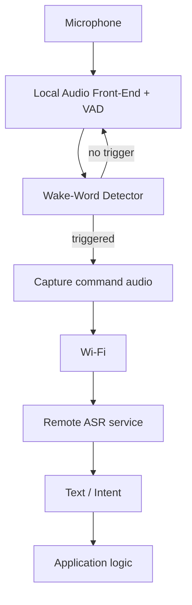

#  Edge-First Voice Activation Platform (ESP32-S3 Reference)

## Executive Summary  
- **Open-source Voice Solution:** We’re building an open-source embedded voice-activation platform. It runs wake-word (keyword) detection locally on an ESP32-S3 and only sends buffered command audio to a server **after** the trigger word. This maximizes privacy (no constant streaming) and reduces cloud bandwidth.    
- **Differentiation:** Unlike closed-source platforms, our **platform focus is integration and architecture**, not just wake-word models. We provide a **rolling audio buffer**, event-driven networking, and backend-agnostic API so OEMs can customize ASR backends. Espressif’s ESP-SR already does local KWS; our value-add is packaging that into a reusable system for product engineers (privacy gating, configuration).  
- **Competitive Context:** Commercial alternatives include Picovoice (Porcupine) and Sensory’s TrulyHandsfree, which offer on-device wake-word engines and SDKs. Dedicated voice chips (e.g. Syntiant NDP120) and high-end MCUs (STM32 N6 series) target lower power or higher performance. Cloud services (Alexa, Google) require continuous streaming. Our niche is the **low-cost embedded segment** (IoT, appliances, wearables) that needs *some* local processing plus flexible cloud ASR.  
- **Next Steps:** Technical validation is key: measure false-accept/false-reject rates, end-to-end latency, resource usage and bandwidth in prototype tests. Simultaneously, interview potential embedded-product OEMs to validate if an **open-source reference integration** solves their pain points more than existing SDKs.  

## Problem Statement  
Embedded-product makers (IoT devices, appliances, robotics, etc.) **want voice interfaces** (e.g. “Hey <device>…”), but building them is complex. They need to integrate: microphone front-end, noise suppression, wake-word spotting (KWS), audio buffering, network connectivity, ASR backend, intent parsing, and privacy controls. Offloading everything to the cloud wastes bandwidth and raises privacy/latency issues; doing full ASR on-device requires expensive MCUs. 

**Problem:** How can a low-cost embedded device add “Alexa/Siri-like” voice control **without continuously streaming audio to the cloud**, and while fitting within tight cost/power/bandwidth budgets?
---
## How It Works

1. Mic audio is cleaned (echo cancellation, noise suppression, VAD) and fed to an always-on wake-word engine.
2. A short rolling buffer (5–10s) holds recent audio so nothing is lost right before the trigger.
3. On wake-word detection ("Utho Kikkar"), the device stops buffering, captures the following command audio, and sends **only that segment** over Wi-Fi to a backend ASR service (cloud or self-hosted).
4. Background audio never leaves the device — only the wake word + command segment is transmitted.

---

## Target Use Cases

| Segment | Why It Fits |
|---|---|
| **ISRO / aerospace operations** | AIT & cleanroom technicians need hands-free control while gloved/suited; mission control and remote telemetry sites need offline, network-isolated wake-word detection; raw audio never leaving the device until triggered aligns with data-sovereignty needs and India's DPDP Act 2025 |
| Industrial / field equipment | Hands-free control in noisy, high-reliability environments |
| Smart home & IoT | Voice-controlled appliances, switches, thermostats |
| Robotics & drones | Start/stop and mode-change voice commands |
| Wearables & assistive devices | Hands-free control for mobility-impaired or outdoor use |
| **Automotive (ADAS vehicles)** *(forward-looking)* | Offline, in-cabin wake word avoids connectivity dependency; a user could enroll their own custom wake word via ~15 spoken repetitions during setup |

---

## Hardware & Competitive Comparison

**Reference MCU — ESP32-S3:** dual-core Xtensa LX7 up to 240MHz, native Wi-Fi/BLE, 512KB SRAM (+ optional PSRAM), NN/DSP acceleration via Helium SIMD. Runs Espressif's ESP-SR framework (Audio Front-End, WakeNet wake-word engine, MultiNet command recognition) — MIT-licensed, open source. Module cost ≈ ₹450–600.

| | **ESP32-S3** (ours) | STM32N6 | Syntiant NDP120 | Picovoice Porcupine |
|---|---|---|---|---|
| Type | MCU, open-source stack | High-end MCU | Dedicated voice chip | Proprietary SDK |
| CPU/NPU | Dual LX7 @240MHz + Helium | Cortex-M55 @800MHz + 600 GOPS NPU | ~6.4 GOPS @<100MHz | Runs on host (e.g. ~0.6% CPU on RPi) |
| RAM | 512KB SRAM | 4.2MB SRAM | ~896KB | N/A (software) |
| Connectivity | Wi-Fi/BLE onboard | Ethernet | None (needs host MCU) | N/A |
| Cost | ~₹450–600 | ~$15–20 | ~$25+ | Free tier + paid licensing |
| Accuracy | ~1 false alarm/12hr (ESP-SR, documented) | ~1 false alarm/12hr | — | ~97.3% accuracy, 1 false alarm/10hr |
| License | Open (MIT) | Open (MIT) | — | Closed-source, commercial license required |

**Takeaway:** ESP32-S3 trades raw AI horsepower for low cost and full Wi-Fi integration. STM32N6 suit higher-performance & ultra-low-power needs, best for a
non-portable living-room setup. Porcupine is the closest commercial KWS benchmark but is closed-source and licensed.

---

## Bill of Materials (Prototype pricing)

| Component | Cost (₹) | Notes |
|---|---|---|
| ESP32-S3 | ~900 | |
| I²S MEMS microphone | ~150 | e.g. INMP441 |
| Li-ion battery (18650) | ~60 | 2.5Ah |
| USB Type-C (×2) | ~40 | |
| 3D-printed enclosure | ~600 | PLA prototype |
| Misc (passives, LEDs) | ~50 | |
| **Total (prototype)** | **~₹1,800** | incl. GST |

Production estimates (injection-molded case, bulk battery/PCB) could bring COGS down to ~₹1,000–1,200/unit, pending supplier quotes.
<b><Note:/b> This is for the complete end-to-end battery-powered portable product, not Minimum Viable Product for the SIH problem statement.
The MVP can be created for Rs 900 (board + mic).

---

## Market Opportunity

Global speech/voice recognition market: **$9.66B (2025) → $23.11B by 2030** (MarketsandMarkets). We are not targeting this whole market — our addressable segment is voice-enabled embedded devices (appliances, IoT, robotics) built on low-cost MCUs, which we'll size bottom-up (unit volume × price) rather than quoting the full market figure as our opportunity.

---

## Privacy & Regulatory Notes

- No audio leaves the device pre-trigger; only the wake word + command segment is transmitted after detection.
- This "local-first" design supports India's **DPDP Act 2025** data-minimization principle, though full compliance depends on the backend ASR provider's data handling — not something we can guarantee from the device side alone.

---

## What Still Needs Validation

- Wake-word accuracy in real world (false-accept / false-reject rate)
- Wake-word-to-ASR latency (end to end, including network)
- RAM/Flash/CPU usage against the 512KB SRAM budget
- Idle vs. active power draw and battery life
- Bandwidth saved vs. always-streaming architectures
- Detection robustness at varying distance/noise levels

All results will be labeled **Measured** once tested; anything untested stays labeled **Hypothesis**.
## References

- [Espressif ESP-SR — GitHub/Docs](https://github.com/espressif/esp-sr)
- Espressif ESP32-S3 module datasheet
- [Picovoice Porcupine — Docs](https://picovoice.ai/docs/porcupine/)
- Syntiant NDP120 product brief
- STMicroelectronics STM32N6 datasheet
- MarketsandMarkets — Speech & Voice Recognition Market forecast
- Mouser Electronics (ESP32-S3 pricing), QuartzComponents (mic pricing), DigiKey (battery pricing)
