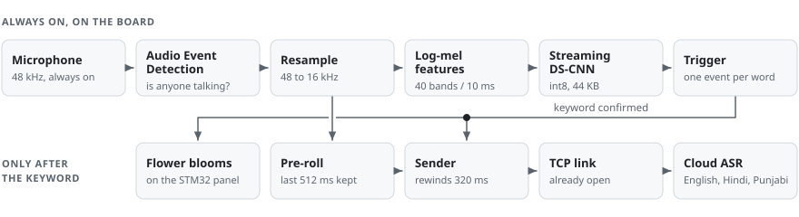
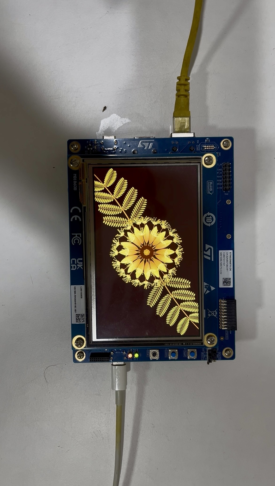
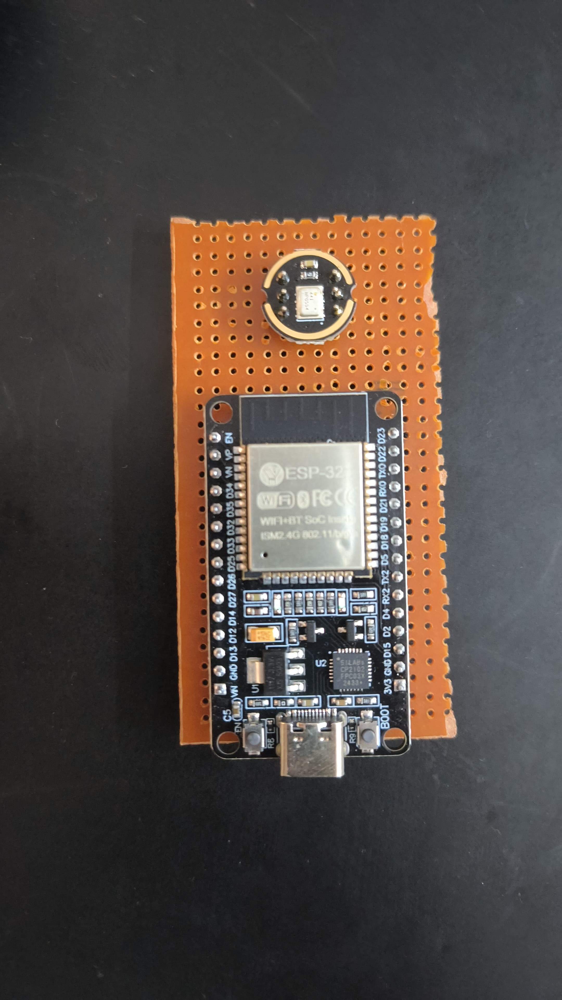
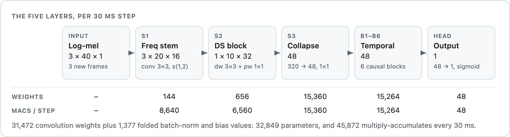
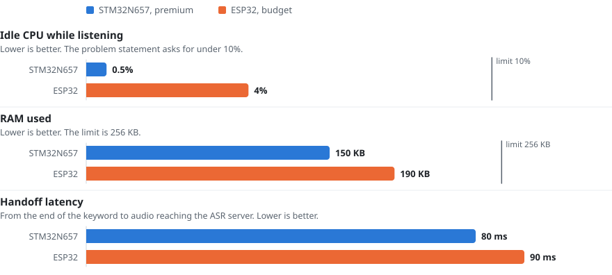
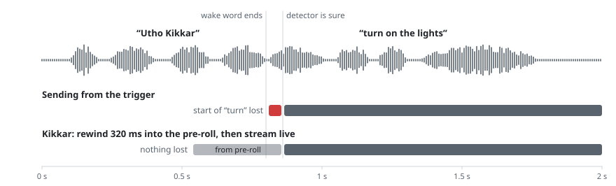
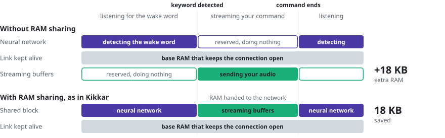
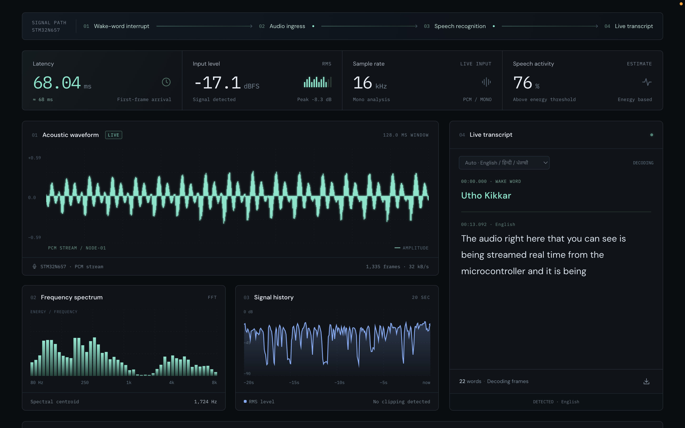

<p align="center">
  
</p>

<h1 align="center">Kikkar</h1>

<p align="center">
  <b>Say "Utho Kikkar" and it blooms. Whatever you say next goes straight to the cloud.</b><br>
  <b>[Try the model live at www.TeamFolklore.site](https://www.teamfolklore.site)</b><br>
</p>

<p align="center">
  
  
  
</p>

<table align="center">
  <tr>
    <td align="center" width="25%"><h2>0.5%</h2>CPU while listening</td>
    <td align="center" width="25%"><h2>150 KB</h2>RAM used</td>
    <td align="center" width="25%"><h2>80 ms</h2>keyword end to cloud</td>
    <td align="center" width="25%"><h2>0.62%</h2>protocol overhead</td>
  </tr>
</table>
<p align="center"><sub>Premium board. The budget board's numbers are lower. <br>
Team has also created a Market Research exploring trade-offs between performance and cost:<br>
https://sherthecoder.github.io/Folklore-Research/</sub></p>

## Why "Utho Kikkar"?

Kikkar (ਕਿੱਕਰ) is what we call the babul tree in Punjab. It is the thorny one
you see along canal banks and field bunds, and for a few weeks every year it
gets covered in small yellow pom-pom flowers. *Utho* means "get up" in both
Hindi and Punjabi, so the wake word is simply "wake up, Kikkar". Say it
whichever way comes naturally to you:

<p align="center"><b>ਉੱਠੋ ਕਿੱਕਰ</b> &nbsp;·&nbsp; <b>उठो किक्कर</b> &nbsp;·&nbsp; <b>Utho Kikkar</b></p>

We wanted a wake word that felt like home, and one that no global assistant
would ever use. We also wanted the device to *show* that it had heard you. A
blinking LED felt too plain, so on the premium board a kikkar flower opens on
the screen every time you wake it up.

Cloud AI centralizes power on foreign servers. Open-source Edge AI brings it home.
Just like India’s Kikkar tree thrives in the harshest landscapes, our custom AI 
architecture is built for extreme endurance on small hardware constraints. 
By rooting our technology locally, we make sure that our <u><b>*languages*</b></u>, <u><b>*culture*</b></u>
and our <u><b>*folklore*</b></u>, are not erased by AI, but are carried forward by it.

## What it does

1. The microphone is always on, but the audio stays on the board. A small
   audio event detector checks whether anyone is talking at all, and only then
   does our streaming int8 neural network listen for "Utho Kikkar", 30 ms at a
   time. Until it hears the wake word, not a single sample goes out.
2. The model is sure 60 ms after you finish saying it. At that moment the
   flower starts to bloom and the board starts streaming your command to the
   server. It starts 320 ms *before* the trigger, so the first syllable of what
   you say doesn't get chopped.
3. Our ASR server transcribes the command while you are still speaking, in
   English, Hindi or Punjabi. When you stop, the flower folds back and the
   board goes back to listening, with the connection kept open for next time.

<picture>
  <source media="(prefers-color-scheme: dark)" srcset="docs/media/pipeline-dark.svg">
  
</picture>

## Two boards, one brain

We built the same system twice. The **premium** version runs on ST's
STM32N657, with an 800 × 480 display, wired Ethernet and a lot of headroom.
There is room on that board to do much more later, like showing photos or
playing video. The **budget** version is a portable ESP32 on a piece of perfboard.
It costs a small fraction of the premium, talks over Wi-Fi and fits in
your pocket.

One is for the drawing room, the other can go anywhere. Both run the same
model, answer to the same wake word and speak the same streaming protocol.

<table>
  <tr>
    <td align="center" width="50%">
      
    </td>
    <td align="center" width="50%">
      
    </td>
  </tr>
  <tr>
    <td align="center"><b>Premium:</b> STM32N6570-DK, flower in full bloom, Ethernet plugged in</td>
    <td align="center"><b>Budget:</b> ESP32 and an I2S microphone on perfboard</td>
  </tr>
</table>

| | STM32N657, premium | ESP32, budget |
|---|---|---|
| Processor | Cortex-M55 at 600 MHz, with Helium vector instructions | Dual-core Xtensa LX6 |
| Microphone | PDM MEMS microphone on the Discovery kit | I2S MEMS microphone module |
| Network | Wired Ethernet, TCP link kept open | Wi-Fi, parked in modem sleep until it is needed |
| Display | 800 × 480, the kikkar flower | None, it runs headless |

## The model

We trained our own model from scratch, for this one phrase and nothing else. It
is a streaming depthwise-separable CNN. Every 30 ms it takes the three newest
frames of log-mel energy, and it remembers just enough of the last one and a
half seconds to tell whether the whole of "Utho Kikkar" has just been said, in
the right order.

<table align="center">
  <tr>
    <td align="center" width="25%"><h2>44 KB</h2>in flash</td>
    <td align="center" width="25%"><h2>32,849</h2>parameters</td>
    <td align="center" width="25%"><h2>45,872</h2>multiply-accumulates per step</td>
    <td align="center" width="25%"><h2>60 ms</h2>phrase end to wake-up</td>
  </tr>
</table>

<p align="center">
  
</p>

| Layer | What it does |
|---|---|
| Frequency stem | A 3 × 3 convolution over time and frequency, 16 channels, while the frequency axis is still there to learn from |
| Depthwise-separable block | A depthwise 3 × 3 filter per channel, then a 1 × 1 mix up to 32 channels |
| Collapse | Folds the 10 remaining frequency bands into one vector of 48 channels |
| Temporal trunk | Six causal blocks with dilations 1, 1, 2, 2, 3 and 3. Each is a depthwise filter over time, a 1 × 1 mix and a residual connection |
| Head | One number through a sigmoid: has "Utho Kikkar" just ended? |

It is trained to say yes only at the very end of the phrase. *Utho* on its
own, *Kikkar* on its own, the two words swapped, and sound-alikes like
*chakkar*, *shakkar* or *kicker* are all taught to it as a no. About 2,000 real
recordings went into it, split by speaker, along with several thousand
renditions from Indian text-to-speech engines and a few rounds of hard
negatives mined from its own mistakes. We have published the synthetic clips as
a dataset,
[SherTheCoder/TeamFolklore_UthoKikkar](https://huggingface.co/datasets/SherTheCoder/TeamFolklore_UthoKikkar).

Every layer that looks back in time keeps a few rows of history between steps,
2,384 bytes in all, so each step only computes what is new. On the STM32 the
whole model runs inside a 5.3 KB arena with our own Helium kernels; on the ESP32
it runs under TensorFlow Lite Micro. The layer table, the memory budget and the
training details are on the model card,
[SherTheCoder/TeamFolklore_Model](https://huggingface.co/SherTheCoder/TeamFolklore_Model).

## The numbers

<picture>
  <source media="(prefers-color-scheme: dark)" srcset="docs/media/metrics-dark.svg">
  
</picture>

| | STM32N657, premium | ESP32, budget | What PS asks for |
|---|---|---|---|
| CPU while idling in continuous listening | **0.5%** | **4%** | under 10% |
| RAM used | **150 KB** | **190 KB** | under 256 KB |
| Latency, keyword end to audio at the ASR server | **80 ms** | **90 ms** | as low as possible |

Both boards sit comfortably inside the limits in the problem statement. The
STM32 idles at half a percent because the Cortex-M55 sleeps between audio hops
and the neural network doesn't run at all while the room is quiet. The ESP32
can't use light sleep (it breaks I2S capture), so it has less room to rest, but
it still uses less than half of the CPU budget. Of the 80 ms of latency, 60 ms
is the model making sure the phrase is over, and the other 20 ms is getting the
first audio to the server over Ethernet. The ESP32 needs 30 ms for that last
part over Wi-Fi, which is why it is around 12% slower.


## What's new here

### The first word of your command never gets cut

<picture>
  <source media="(prefers-color-scheme: dark)" srcset="docs/media/first-syllable-dark.svg">
  
</picture>

A wake-word detector can only be sure after the word is over. Ours is sure
60 ms later, but most people say the wake word and the command in one breath,
so by then the command has already begun. If the board starts sending from the
trigger, "turn on the lights" reaches the server as "...urn on the lights". So Kikkar
keeps the last 512 ms of audio in a ring buffer, and when the keyword is
confirmed it rewinds 320 ms and sends from there before switching to live
audio. The same buffer also feeds the feature extractor, so this costs no
extra RAM.

### One block of RAM does two jobs

<picture>
  <source media="(prefers-color-scheme: dark)" srcset="docs/media/shared-arena-dark.svg">
  
</picture>

Detecting the wake word and streaming your command never happen at the same
time. While the board is listening, the neural network needs its working RAM:
its activations, the 2.4 KB of history it carries from step to step, and the
buffers that turn audio into features for it. Ethernet or Wi-Fi only needs a
small base amount to keep the connection alive. Once the wake word is detected, the model's job is done, so the network
stack takes over the model's RAM for the extra buffers it needs to stream your
audio. When you stop talking, it hands the RAM back and the model starts
listening again from a clean slate.

Without this, the streaming buffers would need their own RAM, sitting unused
every moment the board is only listening. With it, the board does exactly the
same work in **18 KB less RAM**.

Each side has to ask for the block by name. If anything ever tries to hold it
twice, the request fails and a counter goes up, so a mistake shows up as a
number on the serial log and not as garbled audio.

### Audio event detection keeps the model asleep

Right after the microphone sits a tiny audio event detector. It compares the
sound level with a noise floor the board is already tracking, which costs a
single comparison, while the neural network does about 46,000
multiply-accumulates every 30 ms. This comparison is done with help of hardware circuitry of
the Analog Digital Filter on STM board, with zero CPU utilization. Until the 
detector hears something that could be speech, the neural network doesn't run 
at all. The board keeps the last 300 ms of features aside, so when the detector
opens, the model catches up on the syllable that opened it instead of missing
it. Once it is running, the model keeps going for 300 ms after the sound dies down,
so a soft last syllable still gets classified. This, together with keeping the
Ethernet connection open without CPU utilization (with help of DMA's), is where the 
0.5% comes from.

### The line is already open

Connecting to a server takes time: link negotiation, ARP, the TCP handshake.
We do all of that while the board is idle and keep the connection alive between
commands. The audio event detector also gives us an early warning: it hears you
start talking about a second before the wake word can be confirmed. On the
ESP32 that is where Wi-Fi comes out of modem sleep; on the STM32 it checks the
socket and reconnects early if it has dropped. By the time the
keyword is confirmed, the only thing left is to send bytes.

### Four bytes of overhead

Every 20 ms chunk of audio (640 bytes) goes out with a 4-byte header: type,
flags and length. That is 0.62% overhead, about half of what WebSocket framing
would add, and the parser on the device is a struct and a length check instead
of a library. No JSON, no Base64. Further, on the Premium STM board, this 
Ethernet connection is always kept alive without CPU involvement, with help
of Direct Memory Transfers.

### A flower instead of an LED

The flower is not a GIF. It is fifty separate sprites, drawn procedurally in
Blender, animated with springs and composited by the STM32's DMA2D engine at
62.5 frames a second. It reacts while you talk: the petals open wider when you
speak louder, and a deeper voice makes the whole flower swell. When you stop,
it gives a small twirl and folds away.

## On the other end

<p align="center">
  
</p>

Our ASR receiver a moment after a wake-word interrupt from the STM32. The wake
word, "Utho Kikkar", is already in the transcript, and the language box is set
to pick between English, Hindi and Punjabi on its own.

If you want to test the protocol without the dashboard dependency, we've created
[`server/asr_gateway.py`](server/asr_gateway.py), a small receiver with no dependencies. 
It rebuilds each command as a WAV file and can pass it to Whisper or Vosk.

## Where each optimisation lives

| Optimisation | Where it lives | What it does |
|---|---|---|
| **RAM sharing between the model and the network** | [`Appli/Core/Src/opt/opt_arena.c`](Appli/Core/Src/opt/opt_arena.c) | Once the wake word is detected, Ethernet or Wi-Fi reuses the neural network's RAM for its streaming buffers. Saves 18 KB |
| Audio event detection | [`Appli/Core/Src/opt/opt_gate.c`](Appli/Core/Src/opt/opt_gate.c) | Sits right after the microphone; the model only runs while someone is talking, and catches up on the last 300 ms when it starts |
| Idle sleep and CPU accounting | [`Appli/Core/Src/opt/opt_sleep.c`](Appli/Core/Src/opt/opt_sleep.c) | `WFI` between audio hops, and the cycle counting behind the idle CPU figure |
| Early link | [`Appli/Core/Src/opt/opt_link.c`](Appli/Core/Src/opt/opt_link.c) | Link, ARP and TCP are ready before the wake word ends; the moment speech starts, the link is checked again |
| Helium int8 kernels | [`Appli/Core/Src/kws/kws_kernels.c`](Appli/Core/Src/kws/kws_kernels.c) | One vector instruction does sixteen int8 multiply-accumulates |
| Streaming model | [`Appli/Core/Src/kws/kws_model.c`](Appli/Core/Src/kws/kws_model.c) | Each step computes only the three new frames; every layer that looks back keeps its own ring of history, 2.4 KB in all, so nothing is computed twice |
| Incremental features | [`Appli/Core/Src/kws/kws_frontend.c`](Appli/Core/Src/kws/kws_frontend.c) | One new 30 ms frame every 10 ms, normalised against a running mean of the room, so no frame is ever recomputed |
| One microphone ring, two readers | [`Appli/Core/Src/kws/kws_resample.c`](Appli/Core/Src/kws/kws_resample.c) | The keyword spotter reads the animation's audio ring with its own cursor, so the microphone interrupt does no extra work |
| Pre-roll doubles as feature input | [`Appli/Core/Src/kws/kws_preroll.c`](Appli/Core/Src/kws/kws_preroll.c) | One 16 KB buffer feeds the features and saves the first syllable |
| Four-byte framing | [`Appli/Core/Inc/stream/stream_proto.h`](Appli/Core/Inc/stream/stream_proto.h) | 0.62% protocol overhead on every audio chunk |
| Zero-point folding | [`tools/export_kws_model.py`](tools/export_kws_model.py) | The input offset goes into the bias at export time, so every inner loop on the board is a plain dot product. The same script turns the `.tflite` into 23 flat operations, so the board needs no TFLite runtime |
| Model in its own section | [`Appli/STM32N657X0HXQ_LRUN.ld`](Appli/STM32N657X0HXQ_LRUN.ld) | `.kws_model` sits apart from the code, so the model's flash cost is its own line in `make size` |

Most of these can be switched off in
[`kikkar_config.h`](Appli/Core/Inc/app/kikkar_config.h), so each one can be
measured on its own. The ESP32 build follows the same ideas: Wi-Fi shares RAM
with the model once it is connected, the model weights stay in flash, and the
radio waits in modem sleep until the audio event detector hears speech.
[`docs/optimizations.md`](docs/optimizations.md) goes into the details.

## Run it yourself

```sh
git clone https://github.com/SherTheCoder/Folklore.git && cd Folklore
curl -L -o model/kikkar_kws_int8.tflite \
  https://huggingface.co/SherTheCoder/TeamFolklore_Model/resolve/main/kikkar_kws_int8.tflite
make model && make
./server/asr_gateway.py --port 5555        # on the machine that receives audio
./tools/run_on_target.py --free            # build, flash and start the board
```

The full guide, including setting the IP addresses, flashing the first-stage
bootloader and what the serial log should look like, is in
[`Instructions_to_Run.md`](Instructions_to_Run.md).

## What's in the repo

| | |
|---|---|
| [`Appli/Core/Src/kws/`](Appli/Core/Src/kws/) | Keyword spotting: resampler, pre-roll, FFT, log-mel front end, int8 kernels, streaming model interpreter, trigger |
| [`Appli/Core/Src/net/`](Appli/Core/Src/net/) | Ethernet MAC and PHY driver, ARP, IPv4 and a small TCP client |
| [`Appli/Core/Src/stream/`](Appli/Core/Src/stream/) | The wire format, the send queue, one command at a time |
| [`Appli/Core/Src/opt/`](Appli/Core/Src/opt/) | The optimisations in the table above |
| [`Appli/Core/Src/app/`](Appli/Core/Src/app/) | The state machine that ties it all together |
| [`Appli/Core/Src/flower_*.c`](Appli/Core/Src/) | The flower: audio envelope, springs, DMA2D compositing and the display |
| [`server/`](server/) | Reference receiver and a client that replays WAV files |
| [`tools/`](tools/) | Model exporter, asset generator, memory-map check, flashing script and the charts on this page |
| [`docs/`](docs/) | Architecture, protocol, optimisation notes and how we measure |

## Team

Made by **Team Folklore**.
